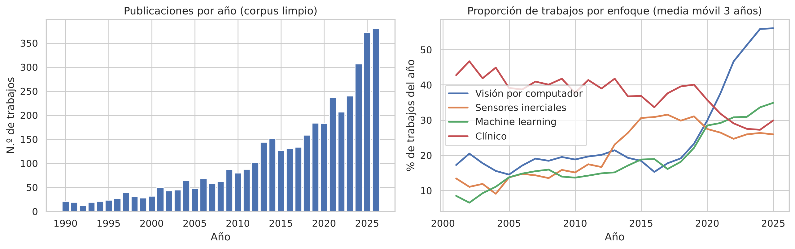
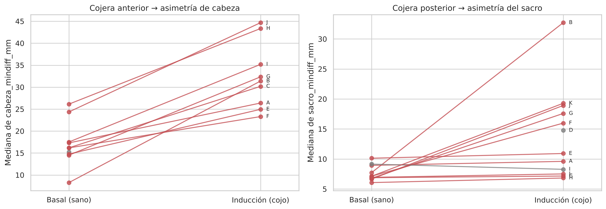
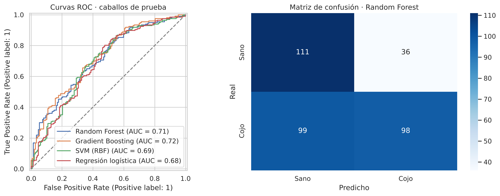
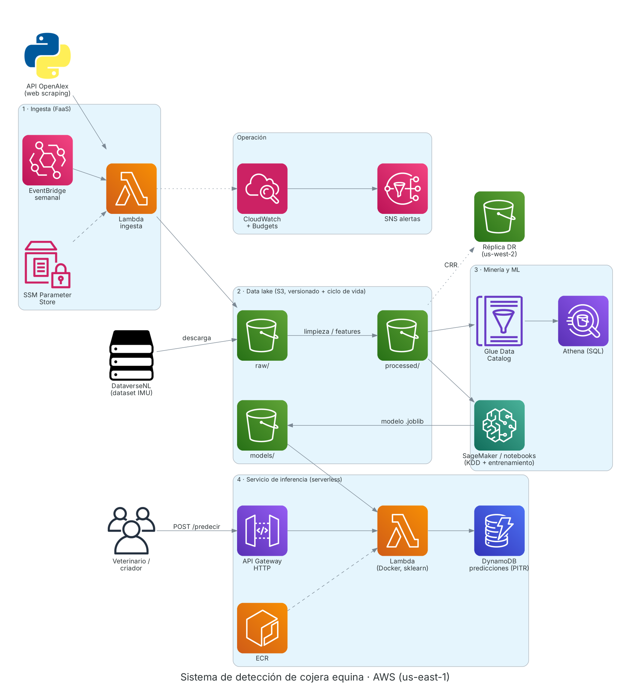

# Detección de cojera equina con minería de datos, machine learning y la nube

**Proyecto integrador · Ingeniería de Datos e Inteligencia Artificial · Universidad Santo Tomás, Tunja**
Autor: **Carlos Josué Barrera Vargas** · Asignaturas: Minería de Datos, Machine Learning y Cloud Computing

La cojera es el problema de salud más común en los caballos y, cuando es leve, los veterinarios no siempre coinciden en el diagnóstico. Este proyecto construye la base de un sistema objetivo y de bajo costo para detectarla. En una fase futura funcionará con video del celular; por ahora trabaja con datos: artículos científicos, un catálogo de datasets públicos y señales de sensores de 22 caballos con cojera inducida. Se alinea con los ODS 3 (salud y bienestar) y 8 (trabajo decente y crecimiento económico).

**Documentos:** [informe final](report/final/CarlosBarrera_informe.pdf) · [póster](report/poster/CarlosBarrera_poster_ES.pdf) · [informe de avance](report/avance/CarlosBarrera_informe.pdf) · [índice de figuras](figuras/README.md)

## Resultados principales

**1. La investigación avanza hacia la visión por computador, pero casi no hay trabajo en Colombia.** De 6.472 registros obtenidos con la API de OpenAlex quedaron 4.024 artículos limpios. El clustering encontró ocho líneas de investigación, y solo un estudio sobre cojera equina con visión tiene autores colombianos.



**2. La asimetría del movimiento delata la cojera.** En la cojera anterior casi se duplica la asimetría de la cabeza; en la posterior aumenta la del sacro y la de las caderas.



**3. El modelo reconoce la cojera en caballos que nunca vio.** Un Random Forest optimizado alcanzó un ROC-AUC de 0,71 con cinco caballos de prueba y acertó 7 de 9 pruebas de trote. SHAP muestra que se apoya en los mismos signos que mira un veterinario.



**4. Todo funciona en AWS casi sin costo.** La infraestructura está escrita en Terraform: ingesta semanal, data lake en S3, consultas con Athena y una API que entrega predicciones y las guarda en DynamoDB. Cuesta unos USD 0,38 al mes en uso académico y el costo real ha sido cero.



## Estructura

```
├── notebooks/        # 01 a 06: el análisis completo, en .ipynb (ejecutado) y .py
├── figuras/          # gráficas de resultados, una carpeta por notebook
├── data/             # datos crudos, procesados y catálogo de datasets
├── models/           # modelo final (.joblib) y sus metadatos
├── src/
│   ├── scraping/     # recolección de artículos desde OpenAlex
│   ├── imu/          # descarga del dataset de sensores y cálculo de métricas por zancada
│   ├── cloud/        # Lambdas de ingesta e inferencia, diagrama, ejemplo de predicción y costos
│   └── api_intellij/ # API en Java (Spring Boot) que consulta el modelo desde Postman
├── terraform/        # infraestructura de AWS como código
├── report/           # informe final, informe de avance y póster
├── herramientas/     # utilidades internas (convertir .py en notebooks)
└── run_pipeline.sh   # ejecuta todo el análisis de principio a fin
```

| Notebook | Qué hace |
| --- | --- |
| `01_articulos_limpieza_eda` | Limpia el corpus de artículos y lo explora |
| `02_articulos_clustering_reglas` | Agrupa los artículos por tema y busca reglas de asociación |
| `03_imu_eda_perfiles` | Explora las señales de los sensores, sus atípicos y perfiles |
| `04_ml_clasificacion_cojera` | Entrena y evalúa el clasificador de cojera |
| `05_catalogo_datasets_perfiles` | Compara los datasets públicos disponibles |
| `06_regresion_impacto_articulos` | Modela qué explica el impacto de un artículo |

## Cómo ejecutarlo

Requisitos: Python 3.11 o superior. Para la nube, además, Terraform 1.6 o superior y la CLI de AWS.

```bash
git clone https://github.com/Cjoh210/Proyecto_Deteccion_Marcha_Equina.git
cd Proyecto_Deteccion_Marcha_Equina
python -m venv .venv && source .venv/bin/activate      # en Windows: .venv\Scripts\activate
pip install -r requirements.txt

bash run_pipeline.sh                # repite el análisis con los datos incluidos
bash run_pipeline.sh --descargar    # o descarga todo desde cero (~6,2 GB de señales)
```

Para descargar desde cero hace falta una clave gratuita de OpenAlex en un archivo `.env` con la línea `OPENALEX_API_KEY=su_clave`. Cada notebook también se puede abrir por separado con `jupyter lab notebooks/`.

### Despliegue en AWS

```bash
cd terraform
cp terraform.tfvars.example terraform.tfvars     # completar los valores; este archivo no se sube al repositorio
terraform init
terraform apply                                  # data lake, ingesta, analítica, base de datos y monitoreo

# API de inferencia (opcional)
aws ecr get-login-password | docker login --username AWS --password-stdin $(terraform output -raw ecr_inferencia | cut -d/ -f1)
docker build --platform linux/amd64 --provenance=false -t $(terraform output -raw ecr_inferencia):latest ../src/cloud/lambda_inferencia
docker push $(terraform output -raw ecr_inferencia):latest
aws s3 cp ../models/modelo_cojera.joblib s3://$(terraform output -raw bucket_datalake)/models/
terraform apply -var desplegar_api_inferencia=true
curl -X POST "$(terraform output -raw url_api)" -H "Content-Type: application/json" -d @../src/cloud/ejemplo_prediccion.json

terraform destroy                                # al terminar, para no generar costos
```

La API en Java se abre en IntelliJ desde `src/api_intellij` y se prueba con la colección de Postman de su carpeta `postman/`.

## Fuentes de datos

- **OpenAlex**, índice abierto de publicaciones científicas: https://openalex.org
- **Smit, I. et al.** *Kinematic data of the Icelandic horse with induced lameness at walk, trot and tölt.* DataverseNL, doi:[10.34894/PEWAK6](https://doi.org/10.34894/PEWAK6), licencia CC BY 4.0. El repositorio incluye solo las métricas calculadas por zancada; las señales crudas se descargan con `src/imu/download_dataset.py`.
- **Catálogo de datasets:** cada fila de `data/external/catalogo_datasets.csv` incluye el enlace a su fuente.

## Decisiones importantes

1. **Validar siempre con caballos nuevos.** Las zancadas de un mismo caballo se parecen tanto que mezclarlas entre entrenamiento y prueba inflaría los resultados.
2. **Interpretar los atípicos antes de borrarlos.** En los artículos son los trabajos más influyentes y en los sensores son, en buena parte, la propia señal de cojera. Solo se eliminaron los registros físicamente imposibles.
3. **Comparar cada caballo consigo mismo**, con la prueba de Wilcoxon emparejada, porque las zancadas de un mismo animal no son independientes.
4. **Arquitectura sin servidores**, que solo cobra cuando trabaja y escala sola.
